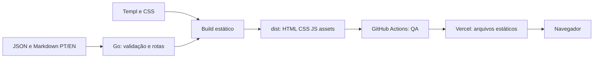

# Neuri Eduardo de Lima — Portfolio

Portfólio pessoal de engenharia de software, desenvolvimento Full Stack, arquitetura distribuída e AI Engineering & Agentic Development. O objetivo é apresentar experiências, projetos e decisões técnicas em um site rápido, bilíngue, acessível e barato de hospedar.

## Stack e arquitetura

| Camada | Tecnologia |
|---|---|
| Geração de páginas | Go + Templ |
| Estilos | Tailwind CSS + CSS próprio |
| Interatividade | HTML/CSS nativos e Alpine.js quando necessário |
| Conteúdo | JSON tipado + Markdown (Goldmark) |
| Ícones / fontes | Lucide SVG, Geist, JetBrains Mono |
| Qualidade | Go test, go vet, Playwright (planejado) |
| CI/CD | GitHub Actions |
| Hospedagem | Vercel, saída estática |



O site não necessita de banco de dados, APIs, serviços pagos ou runtime Go em produção. A Vercel distribui os arquivos já gerados. O uso do plano Hobby está sujeito aos limites e às condições de uso pessoal não comercial.

## Identidade visual

Layout editorial escuro, minimalista, grids de duas colunas, bordas discretas, mini diagramas, tipografia Geist/JetBrains Mono e espaçamento conforme a referência. Paleta: `#0B0E13` (fundo), `#11151C` (surface), `#242A33` (borda), `#EEF1F6` (texto), `#929BA9` (secundário), `#85B7FC` (destaque). Light mode e layout mobile preservam a composição.

## Estrutura prevista

```text
portfolio/
├── cmd/{build,serve}/
├── internal/{site,components,layouts,pages}/
├── content/{pt,en}/
├── assets/{css,js,fonts}/
├── public/
├── scripts/
├── tests/e2e/
├── .github/workflows/
├── Makefile
├── go.mod
├── go.sum
├── package.json
└── README.md
```

`dist/`, `.vercel/`, `node_modules/`, caches e arquivos privados não devem ser versionados. A política de geração Templ deve constar aqui após o bootstrap.

## Desenvolvimento local

Pré-requisitos atuais: Go 1.26.4 e Make opcional. O gerador usa Templ 0.3.960. O CSS atual é local; a compilação Tailwind ainda está pendente.

```bash
make setup           # baixar dependências Go
make generate        # gerar código Go a partir de Templ
make fmt             # formatar código
make build           # gerar dist/
make dev             # gerar e servir dist/ em localhost:8080; sem watch
make test            # testes Go
make check           # geração, testes, build e vet
make vercel-output   # empacotar dist/ no formato Build Output API
```

No Windows sem Make: `go mod download`, `go run github.com/a-h/templ/cmd/templ@v0.3.960 generate`, `go run ./cmd/build`, `go run ./cmd/serve`, `go test ./...`, `go vet ./...` e `go run ./cmd/vercel-output`. O diretório `dist/` contém a saída local. O deploy requer SEO e domínio reais antes de publicação.

## Conteúdo e rotas

Português em `/`; inglês sob `/en/`. Rotas equivalentes: `/about/`, `/experience/`, `/projects/`, `/projects/fobras-next/`, `/projects/despesa360/`, `/projects/find-my-dev/`, `/projects/teleflow/`, `/ai-engineering/`, `/stack/`, `/resume/`, `/contact/`, `/blog/`. Artigos individuais são gerados apenas a partir de Markdown publicado. A home preserva todas as seções e âncoras da referência.

Projetos: FoBras Next (CRM e ERP), Despesa360 (gestão de despesas), Find My Dev (plataforma SaaS de desenvolvedores), TeleFlow (automação Telegram). Cases devem indicar claramente o que está implementado versus planejado, com diagramas conceituais. Não incluir informações corporativas internas, indicadores quantitativos, telefone, credenciais ou imagens sem autorização. Links GitHub, certificações, downloads de currículo e domínio devem ser preenchidos somente com dados aprovados. **Currículos de candidatura com métricas privadas não devem entrar no repositório público.**

## Publicação planejada

1. Criar/vincular o projeto Vercel e configurar `SITE_URL` com o domínio real.
2. Configurar GitHub Actions Secrets `VERCEL_TOKEN`, `VERCEL_ORG_ID`, `VERCEL_PROJECT_ID`; usar variável `SITE_URL` para o domínio.
3. Executar CI e validar `dist/`. Empacotar os arquivos em `.vercel/output/static/` e criar a configuração v3 de Build Output API.
4. Após autorização, executar o workflow manual de deploy. Validar rotas e página 404 na URL de publicação. Evitar deploy duplo se houver integração Git automática.

A pipeline deverá usar a CLI fixada e deploy prebuilt, sem entregar segredos ao navegador. Nenhum deploy foi realizado nesta fase. Veja [Build Output API](https://vercel.com/docs/build-output-api), [deploy prebuilt](https://vercel.com/docs/cli/deploy), [Hobby](https://vercel.com/docs/plans/hobby) e [renderização estática Templ](https://templ.guide/static-rendering/generating-static-html-files-with-templ/).

## Checklist de entrega

- [ ] Bootstrap Go/Templ e build estático
- [ ] Identidade visual fiel e responsiva
- [ ] Home, projetos, experiência, stack, AI Engineering e formação
- [ ] Páginas individuais, conteúdo bilíngue e tema
- [ ] Blog, currículos públicos condicionais e command palette
- [ ] SEO, sitemap, Open Graph, RSS e 404
- [ ] Testes automatizados e QA visual
- [ ] CI e artefato Vercel prebuilt
- [ ] Revisão de dados pessoais e corporativos, autorização de publicação
