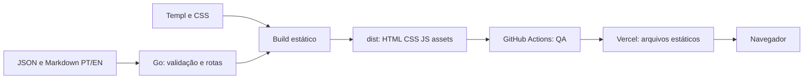

# Neuri Eduardo de Lima — Portfolio

Portfólio pessoal de engenharia de software, desenvolvimento Full Stack, arquitetura distribuída e AI Engineering & Agentic Development. O objetivo é apresentar experiências, projetos e decisões técnicas em um site rápido, bilíngue, acessível e barato de hospedar.

## Stack e arquitetura

| Camada | Tecnologia |
|---|---|
| Geração de páginas | Go + Templ |
| Estilos | Tailwind CSS + CSS próprio |
| Interatividade | HTML/CSS nativos e JavaScript local |
| Conteúdo | JSON tipado + Markdown (Goldmark) |
| Ícones / fontes | SVG local, Geist, JetBrains Mono |
| Qualidade | Go test, go vet, Playwright e Lighthouse |
| CI/CD | GitHub Actions |
| Hospedagem | Vercel, saída estática |



O site não necessita de banco de dados, APIs, serviços pagos ou runtime Go em produção. A Vercel distribui os arquivos já gerados. O uso do plano Hobby está sujeito aos limites e às condições de uso pessoal não comercial.

## Identidade visual

Layout editorial escuro, minimalista, grids de duas colunas, bordas discretas, mini diagramas, tipografia Geist/JetBrains Mono e espaçamento conforme a referência. Paleta: `#0B0E13` (fundo), `#11151C` (surface), `#242A33` (borda), `#EEF1F6` (texto), `#929BA9` (secundário), `#85B7FC` (destaque). Light mode e layout mobile preservam a composição.

## Estrutura

```text
portfolio/
├── cmd/{build,serve,vercel-output}/
├── internal/{site,pages}/
├── content/{pt,en}/
├── assets/{css,js}/
├── public/
├── scripts/
├── .github/workflows/
├── Makefile
├── go.mod
├── go.sum
├── package.json
└── README.md
```

`dist/`, `.vercel/`, `node_modules/`, `.cache/` e materiais locais em `docs/` são ignorados pelo Git. O código `*_templ.go` é gerado por Templ, versionado e verificado contra mudanças de geração no CI; não deve ser editado manualmente.

## Desenvolvimento local

Pré-requisitos atuais: Go 1.26.4, Node.js 24.15.0, npm 12.2.0 e Make opcional. O gerador usa Templ 0.3.960 e Tailwind CSS 4.3.5, com CSS próprio para o layout. Geist e JetBrains Mono são copiados localmente dos pacotes fixados no lockfile, junto com suas licenças.

```bash
make setup           # baixar dependências Go
make generate        # gerar código Go a partir de Templ
make fmt             # formatar código
make build           # gerar dist/
make dev             # gerar e servir dist/ em localhost:8080; sem watch
make test            # testes Go
make check           # geração, testes, build, vet e links internos
make vercel-output   # empacotar dist/ no formato Build Output API
```

No Windows sem Make: `go mod download`, `npm ci`, `go run github.com/a-h/templ/cmd/templ@v0.3.960 generate`, `go run ./cmd/build`, `npm run css`, `npm run fonts`, `npm run check:links`, `go run ./cmd/serve`, `go test ./...`, `go vet ./...` e `go run ./cmd/vercel-output`. Execute os comandos de build na ordem indicada; o gerador Go recria `dist/`. O deploy requer SEO e domínio reais antes de publicação.

Sem `SITE_URL`, todas as páginas recebem `noindex` e `robots.txt` bloqueia indexação. Com uma origem HTTPS válida em `SITE_URL`, o build gera canonical, hreflang, Open Graph básico e sitemap. A configuração do domínio e a revisão do conteúdo devem ocorrer antes de qualquer deploy.

Artigos aprovados podem ser adicionados em `content/pt/blog/` e `content/en/blog/` como arquivos `<slug>.md`. Cada arquivo começa com `---`, seguido de `slug:`, `title:`, `date:` (AAAA-MM-DD), `published: true` e outro `---`. Artigos publicados precisam existir nos dois idiomas com o mesmo slug e data; o HTML gerado é sanitizado. O RSS por idioma é gerado quando há artigos publicados e `SITE_URL` está configurada. Atualmente não há artigos aprovados.

Downloads de currículo ficam desabilitados por padrão. Para habilitá-los após revisão do conteúdo e dos metadados, coloque `resume-approved-pt.pdf` e `resume-approved-en.pdf` em `public/` e defina `PUBLISH_RESUMES=true` no build. O build exige ambos os arquivos, cabeçalho PDF e limite de 10 MB. Não use currículos de candidatura com dados internos.

`npm run qa:visual` abre o site gerado em Chromium, testa navegação por teclado, idioma, tema, 404 e overflow nas larguras 1440, 1024, 768 e 390px. As capturas ficam em `.cache/qa/`, fora do bundle e do Git. Quando a referência local está disponível, o script também captura a referência nas mesmas dimensões. Na comparação local, a estrutura, grids, cores e espaçamentos ficaram próximos; conteúdo revisado, controles adicionais e fontes locais explicam as diferenças visíveis. Não houve medição pixel a pixel.

`npm run qa:lighthouse` grava o relatório em `.cache/qa/lighthouse.json`. Medição local em Chromium 159, Playwright 1.65.1, Lighthouse 13.6.0 e Windows: Performance 95, Accessibility 100, Best Practices 100, SEO 63. O SEO local está limitado pelo `noindex` e pelo `robots.txt` intencionais; a nota de produção depende de domínio real e novo teste.

## Conteúdo e rotas

Português em `/`; inglês sob `/en/`. Rotas equivalentes: `/about/`, `/experience/`, `/projects/`, `/projects/fobras-next/`, `/projects/despesa360/`, `/projects/find-my-dev/`, `/projects/teleflow/`, `/ai-engineering/`, `/stack/`, `/resume/`, `/contact/`, `/blog/`. Artigos individuais são gerados apenas a partir de Markdown publicado. A home preserva todas as seções e âncoras da referência.

Projetos: FoBras Next (CRM e ERP), Despesa360 (gestão de despesas), Find My Dev (plataforma SaaS de desenvolvedores), TeleFlow (automação Telegram). Os cases usam descrições e diagramas conceituais; recursos não confirmados são indicados como escopo de projeto. Dados acadêmicos específicos estão omitidos até validação. Links GitHub, certificações, downloads de currículo e domínio dependem de dados aprovados. **Currículos de candidatura com métricas privadas não devem entrar no repositório público.**

## Publicação planejada

1. Criar/vincular o projeto Vercel e configurar `SITE_URL` com o domínio real.
2. Configurar GitHub Actions Secrets `VERCEL_TOKEN`, `VERCEL_ORG_ID`, `VERCEL_PROJECT_ID`; usar variável `SITE_URL` para o domínio.
3. Executar CI e validar `dist/`. Empacotar os arquivos em `.vercel/output/static/` e criar a configuração v3 de Build Output API.
4. Preparar o workflow manual de deploy quando o projeto estiver vinculado. Validar rotas e página 404 em preview antes de publicar. Evitar deploy duplo se houver integração Git automática.

O workflow de deploy ainda não foi criado porque o projeto Vercel não está vinculado. O empacotamento local gera `.vercel/output/static/` e `config.json` v3. Nenhum deploy foi realizado. Veja [Build Output API](https://vercel.com/docs/build-output-api), [deploy prebuilt](https://vercel.com/docs/cli/deploy), [Hobby](https://vercel.com/docs/plans/hobby) e [renderização estática Templ](https://templ.guide/static-rendering/generating-static-html-files-with-templ/).

## Checklist de entrega

- [x] Bootstrap Go/Templ e build estático
- [x] Identidade visual responsiva implementada e comparada em quatro larguras; refinamento visual em preview pendente
- [x] Home, projetos, experiência, stack, AI Engineering e formação
- [x] Páginas individuais, conteúdo bilíngue e tema
- [x] Currículos públicos condicionais, blog Markdown e busca de navegação implementados; PDFs públicos ainda não fornecidos
- [x] SEO condicionado ao domínio, sitemap, Open Graph, RSS condicional e 404; validação em preview pendente
- [x] Testes automatizados e QA visual local; SEO de produção pendente
- [x] CI do GitHub Actions executado com sucesso e artefato Vercel prebuilt gerado localmente; preview pendente
- [ ] Revisão de dados pessoais e corporativos, autorização de publicação
